# OCODR: One Citizen, One Digital Record

A web platform where every Sri Lankan citizen gets one digital identity that holds their records for life: birth, health, school, university, passport, licence, marriage. Hospitals, schools, police and other offices read and update only the part they're allowed to touch, so nobody has to carry the same paper documents from office to office.

Built for Computing Project, International College of Business and Technology. Team project of 5.

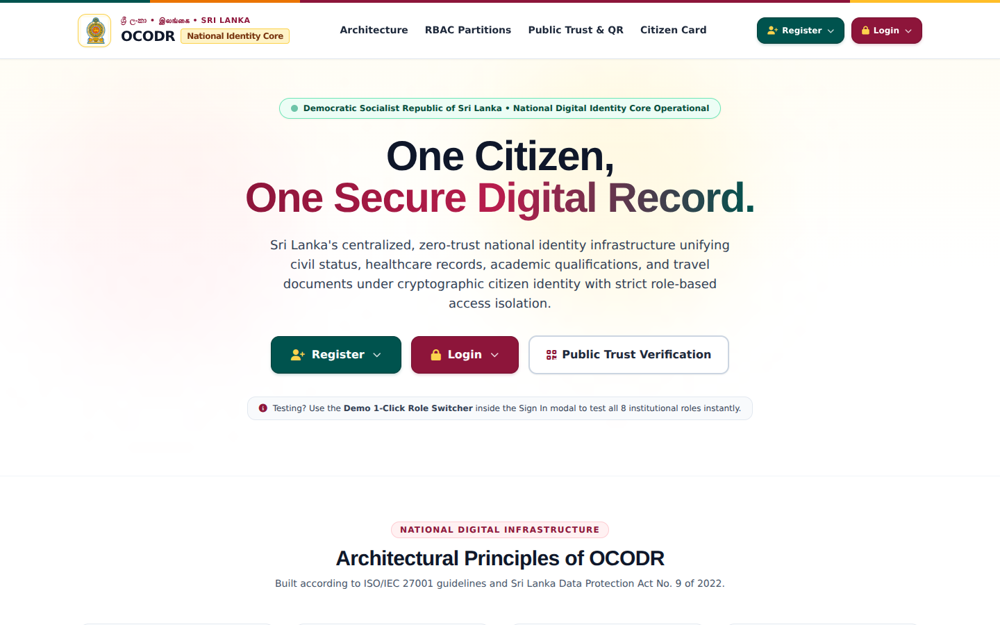

## What it does

- **Digital ID card** with a unique citizen ID, a photo, the name in English, Sinhala and Tamil, and a QR code.
- **Public QR check.** Anyone can scan a card and see whether it's valid. Only a masked NIC is shown.
- **Ten roles with their own access:** citizen, hospital, school, university, registrar, police, immigration, revenue, land registry and admin. A doctor sees medical records and nothing else.
- **Login with a one-time code.** The code is emailed, or printed in the server console if you haven't set up email.
- **Records for each part of a life:** birth registration, vaccinations, medical history, school results, degrees, passport, driving licence, marriage, death.
- **Document upload** for scans and certificates, tied to a citizen.
- **Audit log.** Every view and change is recorded with who did it, when, and from which IP. Admins can read it.

## Screenshots

### Landing Page


### Sign In — Triple-Factor Authentication
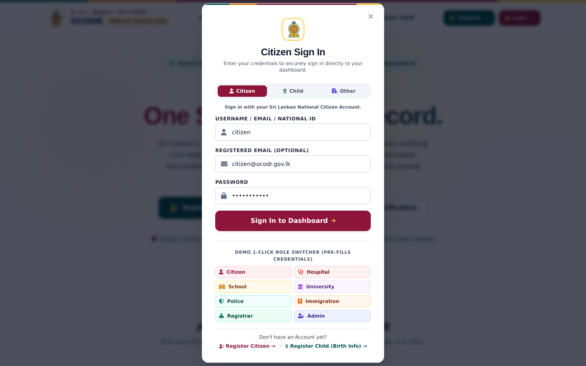

### Citizen Digital ID Card
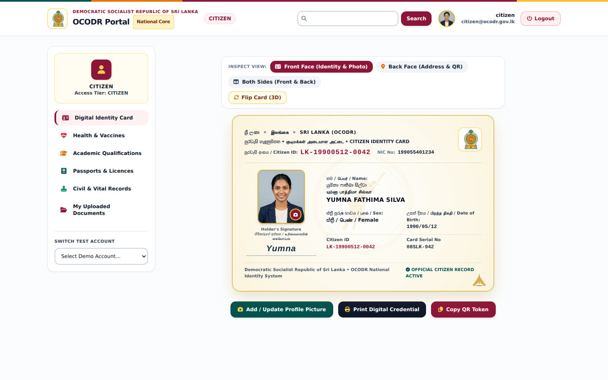

### Health & Vaccination Records
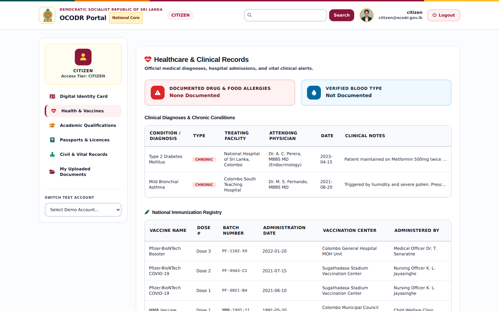

### Education Records
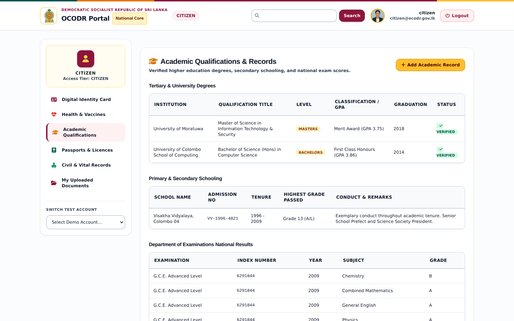

### Travel Documents — Passport & Driving Licence
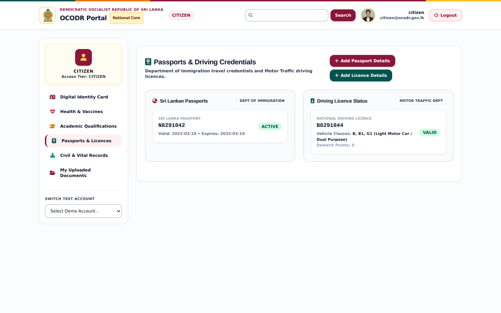

### Civil Records — Birth, Marriage & Death
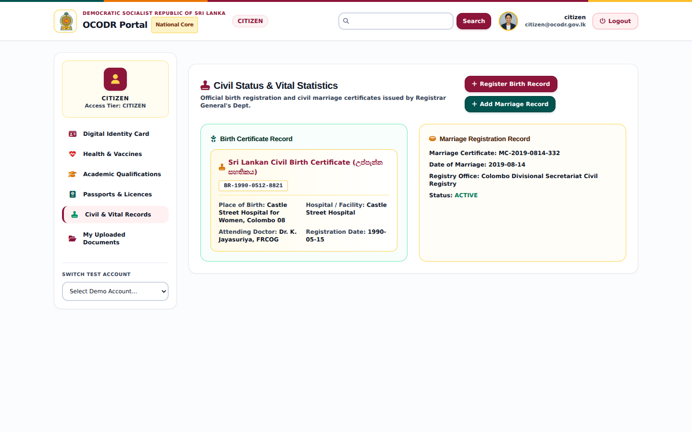

### Hospital Portal — Medical Staff View
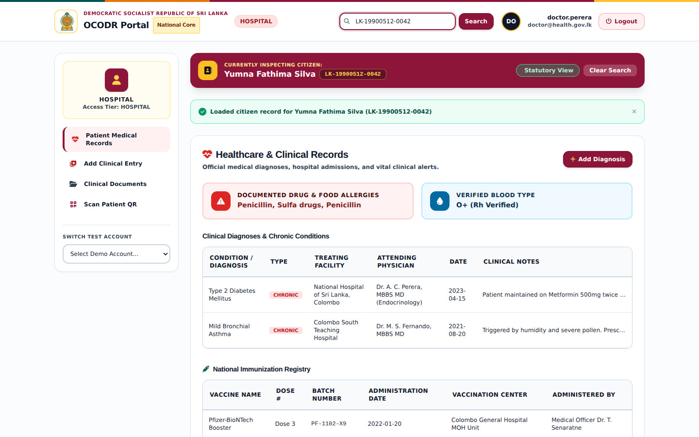

### Registrar — Birth Registration
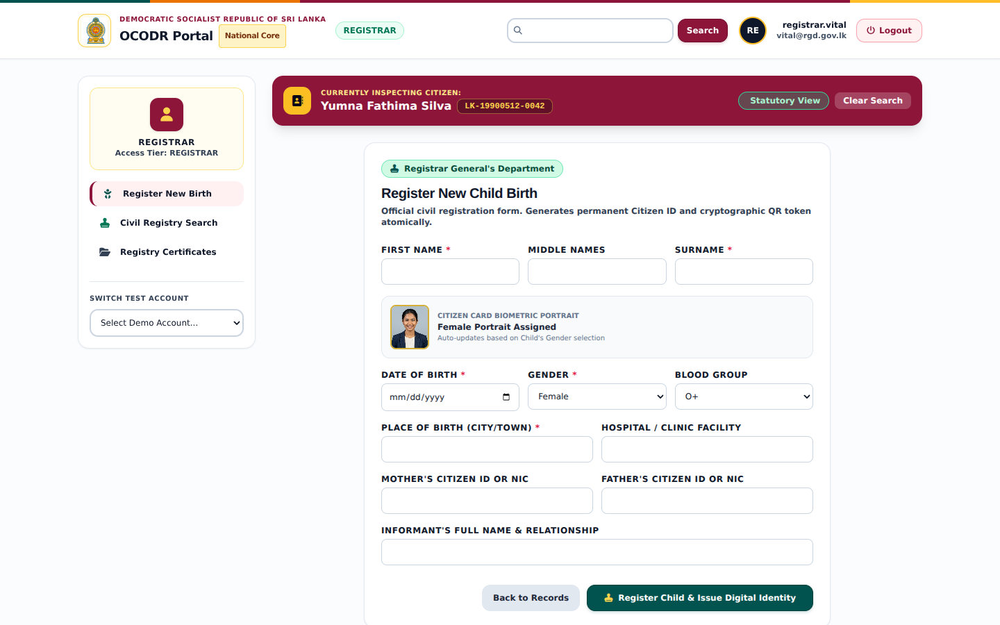

### Admin — National Citizen Registry
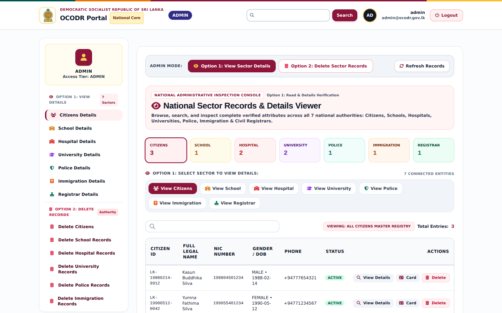

### Admin — Audit Trail
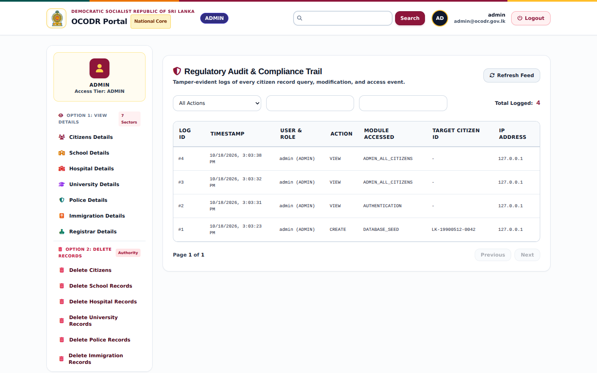

## Tech stack

- Node.js and Express for the API
- MySQL (tested on MariaDB 10.11 and XAMPP)
- JWT for sessions, bcrypt for passwords
- Plain HTML and JavaScript on the front end, with Tailwind, Font Awesome and QR libraries loaded from CDNs (you need internet for the page to look right)
- Multer for uploads, Nodemailer for email

## Run it locally

You need Node.js 18 or newer and MySQL (XAMPP works).

```bash
git clone https://github.com/AjmalRizz/One-Citizen-One-Digital-Record-System-.git
cd One-Citizen-One-Digital-Record-System-
npm install
```

1. Start MySQL.
2. Create the database and tables:
   ```bash
   mysql -u root -p < database/schema.sql
   ```
3. Copy the env file and set `JWT_SECRET` (the file shows a command to make one). Change the DB settings if your MySQL has a password.
   ```bash
   cp .env.example .env
   ```
4. Add the roles and demo data:
   ```bash
   npm run seed
   ```
5. Start the server. On Windows you can double-click `run.bat` instead.
   ```bash
   npm start
   ```

Open http://localhost:5000.

## Demo accounts

Everything seeded uses the password `password123`. The Sign In window has a role switcher that fills these in for you.

| Role | Username |
|---|---|
| Citizen | `citizen` |
| Hospital | `doctor.perera` |
| School | `principal.bandara` |
| University | `registrar.uoc` |
| Registrar General | `registrar.vital` |
| Police | `officer.fernando` |
| Immigration | `officer.wickramasinghe` |
| Admin | `admin` |

**Warning:** These accounts and the demo shortcut that skips the one-time code are for demos only. Remove them before putting this anywhere real.

## Project layout

```
database/schema.sql     tables
src/server.js           app entry
src/routes/             API routes
src/controllers/        request logic
src/middleware/         auth, audit logging, uploads
src/utils/              email, name transliteration, browser launcher
src/scripts/            seed and test scripts
public/                 pages, CSS, front-end JS, images
uploads/                user uploads (git-ignored, except two demo photos)
```

## Tests

With the server running and the database seeded:

```bash
npm run test:api
```

It runs 10 checks end to end: logins for each role, access limits, a birth registration, QR verification and the audit log. The other `test:*` scripts cover photo upload, editing, deleting and the login flow. `npm run clean:data` removes records the tests created.

## API at a glance

| Path | What it's for |
|---|---|
| `POST /api/auth/login`, `/send-otp`, `/verify-otp`, `/register` | sign in and sign up |
| `GET /api/auth/me` | current user |
| `/api/citizens/:citizenId` | a citizen's profile and records |
| `/api/documents` | upload, list, download, delete documents |
| `GET /api/verify/qr/:qrToken` | public QR check |
| `GET /api/audit/logs` | audit trail (admin only) |
| `/api/admin/*` | admin views and deletes (admin only) |
| `GET /api/health` | is the server up |

## Team

| Name | Role |
|---|---|
| Yumna Faris | TODO |
| Hana Hilmy | TODO |
| Uzman Badusa | TODO |
| Ajmal Rizwan | TODO |
| Ahmad Bilaal | TODO |

## License

ISC
